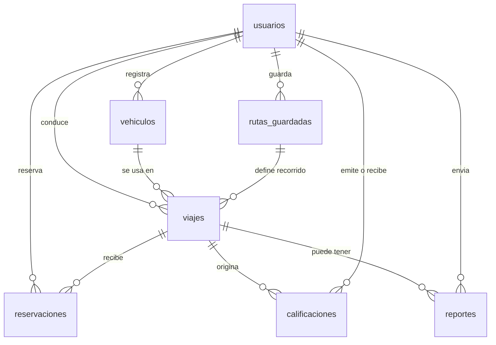

# Documentación Técnica del Proyecto Raity

## 1. Qué es Raity y qué problema resuelve

Muchos estudiantes de la Universidad Autónoma de Baja California Sur (UABCS), campus La Paz, necesitan trasladarse todos los días desde distintas colonias de la ciudad hacia la universidad y de regreso. Actualmente, quienes buscan compartir carro o pedir "raite" tienen que preguntar en grupos dispersos de WhatsApp, redes sociales o entre conocidos, lo que vuelve difícil coincidir en horarios y rutas, además de generar desconfianza al viajar con personas no verificadas.

**Raity** resuelve este problema mediante una plataforma web exclusiva para estudiantes de la UABCS. Conecta a estudiantes conductores que tienen lugares disponibles en su vehículo con estudiantes pasajeros que van hacia destinos parecidos. Para dar mayor seguridad a las estudiantes mujeres, incluye la modalidad **Raity Violeta**, donde solo conductoras mujeres pueden publicar viajes y únicamente pasajeras registradas con género Mujer pueden verlos y reservarlos.

---

## 2. Qué es una PWA y por qué elegimos hacer la app así

Una **PWA** (del inglés *Progressive Web App*, o Aplicación Web Progresiva) es una página web construida con tecnologías estándar (HTML, CSS y JavaScript) que puede comportarse e instalarse casi igual que una aplicación móvil tradicional.

Elegimos hacer Raity como una PWA por las siguientes razones:

1. **Multiplataforma con un solo código:** funciona en teléfonos Android, iPhone, tabletas y computadoras sin tener que programar dos aplicaciones diferentes.
2. **Instalable desde el navegador:** gracias al archivo `manifest.json` y al `service-worker.js`, el estudiante puede agregar el ícono de Raity a la pantalla de inicio de su celular y abrirla en pantalla completa.
3. **Soporte básico sin conexión:** el *Service Worker* (un archivo JavaScript que corre en segundo plano en el navegador) guarda en caché los archivos de la interfaz (HTML, CSS, JS, íconos) para que la aplicación abra incluso cuando falla el internet y muestre una barra avisando que no hay conexión con el servidor.
4. **Costo cero:** no requiere pagar cuentas en tiendas de aplicaciones ni herramientas complejas.

---

## 3. Tecnologías usadas y por qué cada una

A continuación se explica cada tecnología elegida para el proyecto y la razón por la que forma parte del sistema:

* **HTML5 (HyperText Markup Language):** es el lenguaje de etiquetas con el que se construye la estructura de cada pantalla (formularios, botones, encabezados y contenedores). Se usó HTML puro porque es ligero y directo.
* **CSS3 (Cascading Style Sheets):** es el lenguaje que da apariencia visual a las páginas (colores, tamaños, bordes, tipografía y acomodo en pantallas grandes y pequeñas). Se aplicaron las técnicas de la Unidad III (modelo de caja, `float`, `inline-block`, diseño *Mobile First* y *media queries*) para mantener el código claro y fácil de explicar.
* **JavaScript (cliente y servidor):** en el navegador se encarga de hacer interactiva la página, validar formularios y pedir datos al servidor sin recargar toda la pantalla. En el servidor ejecuta la lógica del negocio.
* **Node.js:** es un entorno que permite ejecutar código JavaScript fuera del navegador, es decir, directamente en la computadora o servidor. Se eligió porque permite usar el mismo lenguaje en el frontend y en el backend.
* **Express:** es una librería (un conjunto de herramientas listas para usar) sobre Node.js que facilita crear un **servidor web**, recibir peticiones HTTP (como `GET`, `POST`, `PUT`, `DELETE`) y servir los archivos estáticos de la carpeta `publico/`.
* **PostgreSQL y la librería `pg`:** PostgreSQL es un sistema gestor de **base de datos relacional**, donde la información se guarda en tablas conectadas entre sí. La librería `pg` permite conectar Node.js con PostgreSQL y ejecutar consultas SQL escritas a mano con parámetros seguros (`$1`, `$2`).
* **Leaflet con OpenStreetMap:** Leaflet es una librería ligera de mapas interactivos en JavaScript, y OpenStreetMap es un servicio gratuito de mapas colaborativos que no pide tarjeta ni llave de API comercial, lo cual mantiene el proyecto económicamente factible.
* **bcryptjs:** es una librería de criptografía que convierte las contraseñas en un resumen irreversible llamado *hash* antes de guardarlas en la base de datos. Así, aunque alguien viera la tabla `usuarios`, no podría leer las contraseñas reales.
* **express-session:** es un módulo para Express que recuerda qué usuario inició sesión mediante una *cookie* (un pequeño dato de identificación guardado en el navegador) y mantiene sus datos disponibles en el servidor mientras navega por las pantallas.
* **multer:** es un *middleware* (una función intermedia en Express) especializado en recibir archivos enviados desde formularios HTML (`multipart/form-data`). Se usa para guardar en disco la foto de la credencial universitaria y la foto del vehículo.
* **dotenv:** carga automáticamente la configuración sensible (como la contraseña de PostgreSQL y el puerto del servidor) desde un archivo `.env` que no se debe compartir públicamente.

---

## 4. Cómo está organizado el proyecto

El proyecto se organiza por módulos independientes (cumpliendo el requerimiento RNF07) para que cada parte sea fácil de entender y mantener:

```text
Raity/
  base-de-datos/
    crear-tablas.sql              Define las 7 tablas y sus restricciones en PostgreSQL.
    datos-de-prueba.sql           Inserta usuarios, vehículos, rutas, viajes y calificaciones iniciales.
  publico/
    index.html                    Pantalla de inicio de sesión y registro por pestañas.
    explorar.html                 Mapa principal de La Paz y ruta destacada.
    buscar.html                   Buscador y lista de viajes disponibles.
    publicar.html                 Formulario para publicar un nuevo raite.
    mis-viajes.html               Viaje actual activo e historial de viajes pasados.
    mi-viaje.html                 Detalle de un viaje (vista de conductor o de pasajero).
    perfil.html                   Datos del estudiante, estadísticas, vehículos y rutas.
    registro-vehiculo.html        Formulario para registrar auto y subir fotos.
    registro-ruta.html            Instrucciones, mapa interactivo para marcar 2 puntos y confirmación.
    eliminar-vehiculo-ruta.html   Pantalla para borrar vehículos o rutas guardadas.
    manifest.json                 Metadatos de instalación de la PWA.
    service-worker.js             Caché de archivos para abrir la aplicación sin conexión.
    css/
      estilos.css                 Hoja de estilos externa responsiva (Mobile First).
    js/
      comun.js                    Funciones compartidas (sesión, mapas, avisos y estado de red).
      registrar-sw.js             Registra el Service Worker en el navegador.
      acceso.js                   Lógica de inicio de sesión y registro.
      explorar.js                 Mapa general y tarjeta destacada.
      buscar.js                   Búsqueda en vivo y reservación de asientos.
      publicar.js                 Validación y publicación de viajes.
      mis-viajes.js               Consulta de viaje activo e historial.
      mi-viaje.js                 Pasajeros unidos, iniciar, terminar, cancelar o salir del viaje.
      perfil.js                   Carga de estadísticas, vehículos y rutas en el perfil.
      registro-vehiculo.js        Envío del formulario con imágenes usando FormData.
      registro-ruta.js            Captura de origen y destino con dos clics en el mapa.
      eliminar-vehiculo-ruta.js   Eliminación de vehículos y rutas guardadas.
    imagenes/
      logo_raity.jpg              Logo oficial de Raity.
      icono-192.png               Ícono de la PWA en 192x192 píxeles.
      icono-512.png               Ícono de la PWA en 512x512 píxeles.
  servidor/
    servidor.js                   Punto de entrada: configura Express, sesiones y rutas.
    conexion.js                   Crea el grupo de conexiones (Pool) hacia PostgreSQL.
    package.json                  Lista de dependencias y script de arranque.
    .env.ejemplo                  Plantilla de variables de entorno.
    subidas/                      Carpeta donde multer guarda las imágenes subidas.
    rutas/
      usuarios.js                 Registro, inicio de sesión, cierre de sesión, sesión y perfil.
      vehiculos.js                Alta, consulta y eliminación de vehículos con imágenes.
      rutas-guardadas.js          Alta, consulta y eliminación de rutas de dos puntos.
      viajes.js                   Búsqueda, publicación, detalle, iniciar, terminar y cancelar viajes.
      reservaciones.js            Reserva segura de asientos y cancelación / salida del viaje.
  DOCUMENTACION.md                Este manual completo del proyecto.
  LEEME.md                        Pasos rápidos para instalar y arrancar el sistema.
```

---

## 5. Base de datos

Una **base de datos relacional** guarda información organizada en **tablas** (parecidas a hojas de cálculo), donde cada fila es un registro y cada columna un dato. Para evitar repetir información innecesariamente y mantener consistencia, las tablas se conectan usando **llaves primarias** (`PRIMARY KEY`, el identificador único de cada fila) y **llaves foráneas** (`REFERENCES`, un campo que apunta al identificador de otra tabla).

### Diagrama de relaciones



### Tablas y columnas

1. **`usuarios`**: guarda los datos de identidad de cada estudiante.
   * `id` (`SERIAL PRIMARY KEY`): número único automático del usuario.
   * `nombre_completo`: nombre que se muestra en tarjetas y perfil.
   * `correo_institucional` (`UNIQUE`): correo `@alu.uabcs.mx`, no se puede repetir.
   * `numero_control` (`UNIQUE`): matrícula del alumno, no se puede repetir.
   * `contrasena_cifrada`: contraseña protegida con `bcryptjs`.
   * `genero` (`CHECK`): solo acepta `'Mujer'`, `'Hombre'` o `'Prefiero no decir'`.
   * `es_administrador`: indica si tiene rol de administrador (reservado para versión futura).
   * `activo`: indica si la cuenta está activa.
   * `fecha_registro`: fecha y hora de creación de la cuenta.
2. **`vehiculos`**: guarda los automóviles registrados por los conductores.
   * `id`, `id_usuario` (`REFERENCES usuarios`), `modelo`, `matricula`, `color`, `numero_asientos` (`CHECK` entre 1 y 4), `foto_vehiculo` (ruta del archivo), `foto_credencial` (ruta del archivo).
3. **`rutas_guardadas`**: almacena las rutas origen-destino creadas por cada conductor.
   * `id`, `id_usuario` (`REFERENCES usuarios`), `nombre`, `latitud_origen`, `longitud_origen`, `latitud_destino`, `longitud_destino`.
4. **`viajes`**: representa cada viaje publicado en una fecha y hora específica.
   * `id`, `id_conductor` (`REFERENCES usuarios`), `id_vehiculo` (`REFERENCES vehiculos`), `id_ruta` (`REFERENCES rutas_guardadas`), `origen`, `destino`, `fecha` (por defecto `CURRENT_DATE`), `hora_salida`, `lugares_totales` (`CHECK` 1 a 4), `lugares_disponibles` (`CHECK >= 0` y `<= lugares_totales`), `es_violeta` (booleano), `estado` (`CHECK` entre `'programado'`, `'en_curso'`, `'terminado'` o `'cancelado'`).
5. **`reservaciones`**: registra qué pasajeros apartaron lugar en qué viaje.
   * `id`, `id_viaje` (`REFERENCES viajes`), `id_pasajero` (`REFERENCES usuarios`), `fecha_reservacion`, `estado` (`CHECK` `'activa'` o `'cancelada'`).
6. **`calificaciones`**: almacena puntuaciones (1 a 5) entre usuarios tras un viaje.
   * `id`, `id_viaje`, `id_quien_califica`, `id_calificado`, `puntuacion` (`CHECK` 1 a 5), `comentario`.
7. **`reportes`**: almacena reportes de incidentes vinculados a un viaje.
   * `id`, `id_viaje`, `id_quien_reporta`, `motivo`, `fecha`.

**Por qué se separó así:** un mismo usuario puede tener varios vehículos y varias rutas guardadas, y con un solo vehículo puede publicar decenas de viajes en días distintos. Al separar `vehiculos` y `rutas_guardadas` de `viajes`, no se duplican fotos ni coordenadas cada vez que se publica un viaje. Además, las restricciones `CHECK` garantizan desde la propia base de datos que nunca existan asientos negativos ni puntuaciones inválidas.

---

## 6. Cómo funciona cada parte paso a paso

En JavaScript moderno, cuando la página pide o envía datos al servidor usa `fetch()`, que devuelve una **Promesa** (un objeto que representa una operación que tardará unos milisegundos en responder por la red). Con las palabras clave `async` y `await`, el navegador espera la respuesta de forma ordenada sin congelar la pantalla, y con `try/catch` captura cualquier fallo si el servidor no responde o no hay internet.

1. **Registro (`index.html` -> `acceso.js` -> `POST /api/usuarios/registro`):** el estudiante llena nombre, correo `@alu.uabcs.mx`, número de control, género, contraseña, confirmación y acepta términos. `acceso.js` revisa en pantalla que no falten campos; si falta alguno, los marca con borde rojo y muestra `"Por favor, rellena todos los campos para continuar."`. Si todo está completo, envía un JSON con `fetch()`. En el servidor, `usuarios.js` vuelve a validar el dominio con `DOMINIO_PERMITIDO`, cifra la contraseña con `bcryptjs`, guarda la fila en `usuarios` e inicia sesión automáticamente.
2. **Inicio y cierre de sesión (`acceso.js` y `perfil.js` -> `POST /api/usuarios/iniciar-sesion` / `cerrar-sesion`):** el alumno escribe correo o número de control y contraseña. El servidor busca el registro, compara el *hash* con `bcrypt.compare()`, extiende la *cookie* a 7 días si marcó "Recordarme" y guarda los datos básicos en `req.session.usuario`. Para salir, `perfil.js` llama a `/cerrar-sesion`, destruye la sesión en el servidor y limpia `localStorage`.
3. **Registro de vehículo (`registro-vehiculo.html` -> `POST /api/vehiculos`):** el usuario llena modelo, matrícula, color, asientos (1 a 4) y selecciona dos imágenes (credencial y vehículo). JavaScript empaca todo en un objeto `FormData` (necesario cuando hay archivos binarios) y lo envía por `fetch`. `multer` guarda las imágenes en `servidor/subidas/` y PostgreSQL solo guarda las rutas de texto.
4. **Registro de ruta (`registro-ruta.html` -> `POST /api/rutas-guardadas`):** tras leer las instrucciones, el conductor abre el mapa de La Paz. El primer clic coloca el marcador de origen, el segundo clic coloca el destino y traza una línea recta entre ambos. Al escribir el nombre y guardar, el navegador manda las 4 coordenadas al servidor para guardarlas en `rutas_guardadas`.
5. **Publicar viaje (`publicar.html` -> `POST /api/viajes`):** al entrar, `publicar.js` verifica que el usuario tenga al menos un vehículo y una ruta guardada. Muestra el mapa previo de la ruta elegida. Si el usuario tiene género `'Mujer'`, le permite marcar la casilla **Raity Violeta**. Al enviar, el servidor asigna la fecha del día (`CURRENT_DATE`) y crea el viaje con estado `'programado'`.
6. **Explorar y buscar viajes (`explorar.html` y `buscar.html` -> `GET /api/viajes`):** Explorar muestra todos los viajes disponibles como puntos sobre el mapa de La Paz y destaca el más reciente. Buscar muestra tarjetas con mini mapas y permite filtrar escribiendo en el buscador; el servidor aplica la regla de **Raity Violeta** para ocultar viajes violeta a quienes no tengan género `'Mujer'`.
7. **Reservar asiento (`buscar.js` -> `POST /api/reservaciones`):** al pulsar `"Reservar Asiento"`, el servidor verifica que el pasajero no sea el conductor, que no tenga ya reserva en ese viaje, que cumpla con Raity Violeta si aplica, descuenta 1 asiento de `viajes` de manera segura y registra la fila en `reservaciones`. Después redirige a `mi-viaje.html`.
8. **Mis viajes y gestión de viaje activo (`mis-viajes.html` y `mi-viaje.html`):** muestra el viaje activo arriba y los anteriores abajo. En el detalle del viaje, el conductor puede eliminar a un pasajero (`DELETE /api/reservaciones/:id`), iniciar el viaje (`PUT /api/viajes/:id/iniciar`), terminarlo (`PUT /api/viajes/:id/terminar`) o cancelarlo (`PUT /api/viajes/:id/cancelar`). El pasajero ve el mapa, los compañeros y el botón rojo `"Salir del viaje"`, que cancela su reservación y devuelve el lugar al viaje.

---

## 7. Decisiones y algoritmos

* **Búsqueda sencilla con `ILIKE`:** en `GET /api/viajes` se usó el operador SQL `ILIKE` (`%texto%`) sobre el destino, el origen y el nombre del conductor. Se eligió esta estrategia porque `ILIKE` ignora mayúsculas, minúsculas y funciona rápido en bases de datos medianas y pequeñas sin necesidad de instalar motores externos de búsqueda de texto.
* **Prevención de sobreventa de asientos (RNF05):** si dos pasajeros intentan reservar el último lugar exactamente al mismo tiempo, hacer un `SELECT` primero y luego un `UPDATE` podría dejar que ambos pasen y el cupo quede en `-1`. Para evitarlo, el servidor ejecuta una única instrucción atómica en PostgreSQL:
  `UPDATE viajes SET lugares_disponibles = lugares_disponibles - 1 WHERE id = $1 AND lugares_disponibles > 0`
  La base de datos bloquea esa fila un instante mientras resta 1. Si el segundo usuario llega cuando ya es `0`, la condición `lugares_disponibles > 0` no se cumple, `rowCount` vale `0` y el servidor responde que ya no hay lugares.
* **Protección de contraseñas y consultas SQL:** las contraseñas nunca se guardan en texto plano; se cifran con `bcryptjs` (10 rondas de *salt*). Todas las consultas SQL usan marcadores `$1, $2` en lugar de concatenar cadenas, lo que bloquea ataques de inyección SQL.
* **Validación en el servidor además de la interfaz:** cualquier persona puede modificar el HTML o desactivar JavaScript en su navegador. Por eso, reglas críticas como el dominio `@alu.uabcs.mx`, el límite de 1 a 4 asientos, no reservar el propio viaje y la exclusividad de **Raity Violeta** siempre se validan de nuevo en Express antes de tocar la base de datos.
* **Ruta con dos puntos en lugar de GPS en tiempo real:** como se concluyó en el estudio de factibilidad, el rastreo GPS continuo en segundo plano consume batería, datos y eleva la complejidad técnica y de costos de mapas. Marcar origen y destino sobre Leaflet con OpenStreetMap permite visualizar claramente la trayectoria por toda La Paz sin rastrear en vivo a los estudiantes.

---

## 8. Diseño Mobile First y Responsivo

El archivo `publico/css/estilos.css` sigue el enfoque **Mobile First** visto en la Unidad III:

1. **Estilos base para celular (360 px a 430 px):** todo el diseño nace pensado para pantallas verticales de teléfono, con tarjetas al 100% de ancho, botones cómodos para el pulgar y una barra de navegación fija en la parte inferior.
2. **Meta viewport:** todas las páginas incluyen `<meta name="viewport" content="width=device-width, initial-scale=1">` para que el navegador móvil no encoja el contenido.
3. **Breakpoints usados:**
   * `@media screen and (min-width: 768px)` (móviles horizontales y tablet vertical).
   * `@media screen and (min-width: 1024px)` (tablet horizontal y escritorios normales).
   * `@media screen and (min-width: 1200px)` (escritorios muy anchos).
4. **Patrones aplicados de la Unidad III:**
   * **Layout shifter:** a partir de `768px`, la barra de navegación inferior cambia de posición y se convierte en una barra lateral izquierda fija, mientras el contenido principal se acomoda y centra a su derecha.
   * **Colocación de columnas:** en la pantalla Buscar (`buscar.html`), las tarjetas de viajes disponibles están apiladas una debajo de otra en móvil; a partir de `768px` pasan a mostrarse en dos columnas utilizando `float: left`, anchos en porcentaje (`48%`) y limpieza de flotantes con `.lista-viajes::after { clear: both; }`.

---

## 9. Relación con los requerimientos

| Requerimiento | Descripción resumida | Archivo o pantalla donde se cumple | Estado |
| :--- | :--- | :--- | :--- |
| **RF01** | Crear cuenta con correo institucional | `index.html`, `acceso.js`, `usuarios.js` | Completo |
| **RF02** | Iniciar y cerrar sesión | `index.html`, `perfil.html`, `usuarios.js` | Completo |
| **RF03** | Publicar viaje (origen, destino, hora, lugares) | `publicar.html`, `publicar.js`, `viajes.js` | Completo |
| **RF04** | Buscar viajes por destino o conductor | `buscar.html`, `buscar.js`, `viajes.js` | Completo |
| **RF05** | Reservar y cancelar asiento en un viaje | `buscar.html`, `mi-viaje.html`, `reservaciones.js` | Completo |
| **RF06** | Ver y actualizar información del perfil | `perfil.html`, `registro-vehiculo.html`, `registro-ruta.html`, `eliminar-vehiculo-ruta.html` | Completo |
| **RF07** | Ver las rutas de los viajes en un mapa | `explorar.html`, `buscar.html`, `publicar.html`, `mi-viaje.html`, `comun.js` | Completo |
| **RF08** | Calificar compañeros tras un viaje | `mis-viajes.html`, tabla `calificaciones` | Parcial (botón "Próximamente"; promedio desde datos de prueba) |
| **RF09** | Consultar viajes reservados e historial | `mis-viajes.html`, `mi-viaje.html`, `viajes.js` | Completo |
| **RF10** | Opción Raity Violeta exclusiva para mujeres | `publicar.html`, `buscar.html`, `viajes.js`, `reservaciones.js` | Completo |
| **RF11** | Mostrar credencial digital universitaria | `registro-vehiculo.html` (subida de credencial) | Parcial (se guarda imagen; pantalla digital en trabajo futuro) |
| **RNF01** | Seguridad: exigir correo institucional | `usuarios.js` (`DOMINIO_PERMITIDO`) y `acceso.js` | Completo |
| **RNF02** | Facilidad de uso e interfaz clara | Todas las pantallas HTML y `estilos.css` | Completo |
| **RNF03** | Rendimiento rápido en búsqueda de viajes | `viajes.js` (consulta directa indexada con `ILIKE`) | Completo |
| **RNF04** | Disponibilidad 24 horas y modo sin conexión | `servidor.js` y `service-worker.js` | Completo |
| **RNF05** | Confiabilidad al actualizar asientos | `reservaciones.js` (`UPDATE` atómico) | Completo |
| **RNF06** | Compatibilidad móvil, tableta y escritorio | `estilos.css` (Mobile First y media queries) y PWA | Completo |
| **RNF07** | Código organizado en módulos independientes | Carpetas `servidor/rutas/` y `publico/js/` | Completo |

---

## 10. Alcance de esta versión y trabajo futuro

Por los tiempos del semestre escolar, esta versión entrega el núcleo completo de registro, perfiles, vehículos, rutas en mapa, publicación, búsqueda, reservación segura, estados del viaje y Raity Violeta. Las siguientes funciones quedaron preparadas en la base de datos o en la interfaz con un aviso consistente de **"Próximamente"** para no mostrar botones rotos:

* **RF08 - Calificar conductor:** la tabla `calificaciones` ya almacena puntuaciones de prueba que calculan las estrellas visibles en tarjetas y perfil. En una siguiente entrega, el botón "Calificar Conductor" abriría un formulario de 1 a 5 estrellas con comentario conectado a un endpoint `POST /api/calificaciones`.
* **Reportar viaje:** la tabla `reportes` ya existe en PostgreSQL; faltaría agregar el modal de motivo y una ruta `POST /api/reportes`.
* **Notificaciones en tiempo real:** la campana de Explorar muestra "Próximamente". Se implementaría guardando avisos en una tabla de notificaciones y usando la API *Web Push* dentro de `service-worker.js`.
* **RF11 - Credencial digital universitaria:** actualmente la fotografía de la credencial se sube al registrar el vehículo. Para completar RF11 se agregaría una pantalla dedicada que muestre la credencial cargada junto con el estado de alumno activo.
* **Cálculo exacto de CO2 ahorrado:** actualmente es un dato estimado sencillo (`viajes realizados * 1.2 kg`). A futuro se calcularía la distancia real entre coordenadas usando la fórmula de Haversine.
* **Panel de administrador:** la columna `es_administrador` ya existe en `usuarios`. Faltaría crear vistas protegidas para revisar reportes y validar credenciales subidas.

---

## 11. Glosario de términos

* **API (Application Programming Interface):** conjunto de rutas URL que el servidor ofrece para que el navegador pida o envíe datos en formato JSON.
* **Backend:** la parte del sistema que corre en el servidor (Node.js, Express y PostgreSQL) y que el usuario no ve directamente.
* **Breakpoint:** ancho de pantalla específico (como `768px` o `1024px`) donde cambian los estilos CSS para adaptarse mejor a tabletas o computadoras.
* **Cookie:** pequeño archivo de texto que el navegador guarda para recordar la sesión activa de un usuario.
* **Endpoint:** cada dirección URL concreta del servidor, por ejemplo `POST /api/reservaciones`.
* **Frontend:** toda la parte visual e interactiva que corre dentro del navegador del usuario (HTML, CSS y JavaScript).
* **Hash:** resultado de transformar una contraseña en una cadena ilegible mediante algoritmos matemáticos (como `bcryptjs`), imposible de revertir al texto original.
* **JSON (JavaScript Object Notation):** formato de texto ligero basado en pares clave-valor que usan el navegador y el servidor para intercambiar datos.
* **Llave foránea:** columna de una tabla que guarda el `id` de otra tabla para garantizar que la relación sea válida.
* **Media Query:** regla de CSS (`@media`) que aplica ciertos estilos únicamente cuando la pantalla cumple una condición de tamaño.
* **Middleware:** función intermedia en Express que revisa o procesa una petición antes de llegar a la ruta final (por ejemplo, verificar si hay sesión activa o guardar un archivo subido).
* **Mobile First:** estrategia de diseño web donde primero se escriben los estilos para teléfono celular y después se adaptan hacia pantallas más grandes.
* **Promesa (`Promise`):** objeto de JavaScript que representa una tarea asíncrona (como una petición `fetch`) que terminará con éxito o error en el futuro.
* **PWA (Progressive Web App):** aplicación web que puede instalarse en el dispositivo y usar caché mediante un Service Worker.
* **SQL (Structured Query Language):** lenguaje estándar usado para crear tablas, insertar filas, actualizar datos y hacer consultas en bases de datos relacionales.
