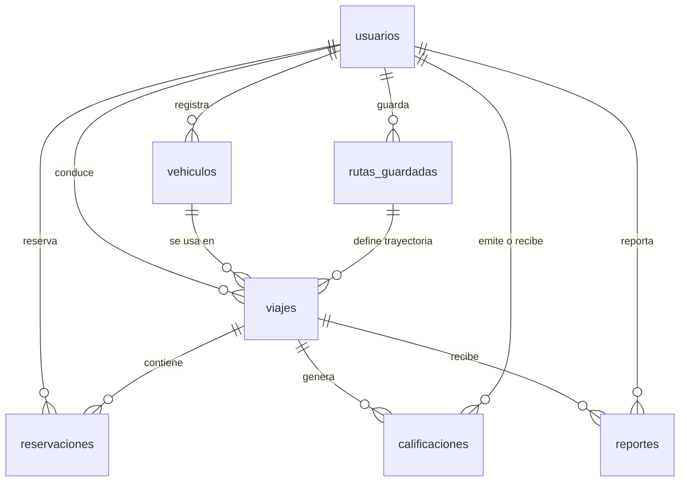

# Documentación Técnica y de Diseño del Proyecto Raity

## 1. Qué es Raity y qué problema resuelve

Cada día, cientos de estudiantes de la **Universidad Autónoma de Baja California Sur (UABCS)**, campus La Paz, necesitan trasladarse desde distintas colonias de la ciudad (como Santa Fe, Fidepaz, Colina del Sol, Agua Escondida, Indeco, Bellavista, Camino Real, Los Olivos o Zona Centro) hasta los distintos edificios y departamentos de la universidad, así como regresar a sus hogares.

Aunque muchos estudiantes conducen su propio automóvil con asientos vacíos y otros dependen del transporte público o de pedir aventón ("raite"), hoy en día la coordinación suele hacerse de manera informal en grupos dispersos de mensajería o redes sociales. Eso ocasiona desorden en horarios, poca certeza sobre quién maneja o qué vehículo pasará, dificultad para encontrar trayectos compatibles y desconfianza al viajar con desconocidos.

**Raity** resuelve este problema mediante una **Aplicación Web Progresiva (PWA)** exclusiva para la comunidad estudiantil de la UABCS en La Paz, Baja California Sur. Sus pilares principales son:

1. **Acceso verificado con correo institucional:** únicamente estudiantes con correo `@alu.uabcs.mx` y número de control universitario pueden crear una cuenta e iniciar sesión.
2. **Conexión ordenada entre conductores y pasajeros:** quienes tienen automóvil y ruta registrada publican viajes indicando origen, destino, hora de salida y asientos disponibles (de 1 a 4); quienes buscan transporte filtran por destino, colonia o conductor y apartan lugar en un clic.
3. **Modalidad Raity Violeta:** un modo de seguridad dedicado donde únicamente estudiantes registradas con género Mujer pueden publicar viajes exclusivos para mujeres, verlos en Explorar y Buscar, y reservar asiento en ellos.
4. **Control claro de viajes y trazado de rutas en La Paz:** el estudiante consulta su viaje activo, los pasajeros unidos, el trazado sobre el mapa de La Paz con OpenStreetMap, inicia/termina/cancela el viaje y, al concluirlo, puede calificar al conductor o enviar reportes.

### Actores del sistema

* **Estudiante (Pasajero):** se registra con correo `@alu.uabcs.mx`, explora el mapa de La Paz, busca viajes disponibles, aparta asientos, sale de un viaje si cambia de planes, consulta su historial, califica al conductor y puede emitir reportes.
* **Conductor:** es un estudiante que además registró al menos un automóvil (modelo, matrícula, color, asientos, foto de credencial universitaria y foto del vehículo) y al menos una ruta en el mapa; puede publicar viajes normales o Raity Violeta, eliminar pasajeros de su viaje actual, iniciar el recorrido, terminarlo o cancelarlo.
* **Administrador (rol preparado en base de datos):** la tabla `usuarios` incluye el campo `es_administrador` para gestionar en una etapa futura la validación de credenciales subidas y la atención de reportes.
* **Servicios externos:** mapas de **OpenStreetMap** mostrados con **Leaflet**, servicio público de ruteo vial **OSRM** (`router.project-osrm.org`) para trazar trayectorias sobre calles reales de La Paz y tipografía **Hammersmith One** desde Google Fonts.

---

## 2. Qué es una PWA y por qué elegimos hacer la app así

Una **PWA** (*Progressive Web App*, o Aplicación Web Progresiva) es una aplicación construida con tecnologías web estándar (**HTML5, CSS3 y JavaScript**) que funciona directamente en cualquier navegador moderno pero agrega capacidades propias de una aplicación móvil instalable.

Elegimos desarrollar Raity como PWA por cuatro razones técnicas y de factibilidad:

1. **Un solo código multiplataforma:** funciona en teléfonos Android, iPhone, tabletas y computadoras sin mantener proyectos separados en Kotlin y Swift.
2. **Instalación sin tiendas ni cuotas:** gracias al archivo [publico/manifest.json](publico/manifest.json) (con nombre `"Raity"`, color de tema `#057A91`, modo `"standalone"` e íconos de `192x192` y `512x512` generados a partir de `logo_raity.jpg`), el usuario puede agregar el ícono directamente a la pantalla de inicio de su celular y abrir Raity sin barras del navegador.
3. **Funcionamiento básico sin conexión y ahorro de datos:** mediante el archivo [publico/service-worker.js](publico/service-worker.js) registrado por [publico/js/registrar-sw.js](publico/js/registrar-sw.js), el navegador guarda en caché local (`raity-cache-v3`) las 10 pantallas HTML, `estilos.css`, los scripts JS y las imágenes de marca. Cuando se pierde la conexión a internet, una barra fija en la parte superior avisa al estudiante, las vistas cargan desde caché local y las peticiones `/api/` devuelven un mensaje JSON controlado (`503`) en lugar de romper la pantalla.
4. **Actualización inmediata:** cada cambio publicado en producción queda disponible automáticamente para todos los estudiantes al recargar, sin aprobar actualizaciones en tiendas externas.

---

## 3. Tecnologías usadas y por qué cada una

Se eligió una pila ligera, sin frameworks pesados ni compiladores complejos, para que todo el equipo pueda leer, mantener y defender cada línea de código:

| Tecnología / Librería | Rol en el proyecto | Por qué se eligió |
| :--- | :--- | :--- |
| **HTML5** | Estructura semántica de las 10 pantallas | Ligero, accesible (`role`, `aria-label`, `aria-live`), fácil de leer y cachear por el Service Worker. |
| **CSS3 (Unidad III)** | Apariencia visual y diseño responsivo Mobile First | Respeta lo visto en clase: modelo de caja, `float`, `inline-block`, `flexbox` sencillo y `@media` (`768px`, `1024px`, `1200px`), sin `grid`, sin variables CSS ni `calc()`. |
| **JavaScript puro (ES6+)** | Lógica en navegador y en servidor | Permite usar un mismo lenguaje en frontend y backend con estructuras directas (`for`, `if`, `fetch`, `async/await`, `try/catch`, `DOM`). |
| **Node.js** | Entorno de ejecución del servidor backend | Ejecuta JavaScript del lado del servidor y unifica el proyecto bajo `npm`. |
| **Express (`express`)** | Servidor HTTP y enrutador de API REST | Organiza limpiamente las rutas `/api/*`, middlewares de sesión, JSON y subida de archivos sin complejidad oculta. |
| **PostgreSQL y `pg`** | Base de datos relacional y conector SQL | Permite diseñar tablas normalizadas con llaves foráneas y restricciones `CHECK`, además de consultas SQL parametrizadas (`$1`, `$2`) que impiden inyección SQL sin usar un ORM. |
| **Leaflet + OpenStreetMap + OSRM** | Visualización de mapas y trazado vial en La Paz | Gratuito, sin tarjeta bancaria ni límite estricto de llaves comerciales; ideal para el estudio de factibilidad escolar. |
| **bcryptjs (`bcryptjs`)** | Cifrado de contraseñas | Transforma cada contraseña en un *hash* irreversible con 10 rondas de *salt* antes de guardarla en PostgreSQL. |
| **express-session + connect-pg-simple** | Manejo de sesiones persistentes | Emite una *cookie* segura (`httpOnly`, `sameSite: 'lax'`) y guarda sesiones en la tabla `sesiones` de PostgreSQL para que sobrevivan en entorno serverless. |
| **Multer (`multer`)** | Recepción de formularios con imágenes (`multipart/form-data`) | Recibe de forma segura hasta 5 MB por archivo para la credencial universitaria y foto del vehículo. |
| **dotenv (`dotenv`)** | Variables de entorno | Separa credenciales y secretos (`SECRETO_SESION`, conexión a PostgreSQL) del código fuente. |
| **Netlify + Netlify Functions v2 + `@netlify/database`** | Alojamiento gratuito en producción sin tarjeta de crédito | Sirve `publico/` desde CDN HTTPS (requisito PWA), ejecuta Express dentro de una función v2 y conecta con PostgreSQL gestionado sin costo inicial. |

---

## 4. Cómo está organizado el proyecto

El código cumple con el requerimiento **RNF07** (organización por módulos independientes), separando base de datos, servidor, interfaz web y configuración de nube:

```text
Raity/
  base-de-datos/
    crear-tablas.sql              Script maestro de creación de tablas, llaves y restricciones CHECK.
    datos-de-prueba.sql           12 estudiantes de La Paz, 8 vehículos, 10 rutas, 14 viajes, reservaciones, calificaciones y reportes.
  netlify/
    database/migrations/          Migraciones SQL versionadas aplicadas automáticamente en Netlify Database.
    functions/api.js              Adaptador Netlify Functions v2 (ruta /api/* y /subidas/*) que envuelve la app Express.
  netlify.toml                    Configuración de compilación, directorio público (publico/) y archivos SQL incluidos.
  package.json                    Dependencias compartidas del proyecto raíz para despliegue en nube.
  publico/
    index.html                    Inicio de sesión y registro con pestañas + modal de Términos y Aviso de Privacidad.
    explorar.html                 Mapa de La Paz en tiempo real, chip de cercanía, ruta destacada y modal de notificaciones.
    buscar.html                   Buscador en vivo, filtros rápidos (Todos, Hacia UABCS, Santa Fe, Raity Violeta) y tarjetas con minimapa.
    publicar.html                 Formulario para publicar un raite con vista previa de ruta y opción Raity Violeta.
    mis-viajes.html               Viaje activo arriba e Historial abajo con botones Reportar y Calificar Conductor.
    mi-viaje.html                 Detalle de viaje (vista conductor con Iniciar/Terminar/Cancelar/Eliminar pasajero, o vista pasajero con Salir del viaje).
    perfil.html                   Datos del estudiante, estadísticas (viajes realizados y CO2), estado Alumno activo, vehículos y rutas.
    registro-vehiculo.html        Formulario multipart para vehículo, foto de credencial y foto del auto.
    registro-ruta.html            Flujo en 3 pasos: instrucciones iniciales, mapa de 2 clics para salida/destino y confirmación de éxito.
    eliminar-vehiculo-ruta.html   Selección y eliminación segura de vehículos o rutas con vista previa en mapa.
    manifest.json                 Metadatos PWA de instalación.
    service-worker.js             Caché offline del cascarón de la app y manejo seguro de fallos de red.
    css/
      estilos.css                 Hoja de estilos externa Mobile First siguiendo los patrones de la Unidad III.
    js/
      comun.js                    Funciones compartidas: verificarSesion, mensajes/errores, modales, trazado de mapas OSRM, respaldo de formularios y detector offline.
      registrar-sw.js             Registra /service-worker.js al cargar la página.
      acceso.js                   Validación y envío de formularios de Login y Registro.
      explorar.js                 Mapa general de La Paz, marcadores, trazado destacado y detalle de la campana de avisos.
      buscar.js                   Consulta con debounce, chips de filtro, render de minimapas y reservación de asiento.
      publicar.js                 Validación previa de vehículo/ruta y publicación de viaje (con bloqueo de Raity Violeta según género).
      mis-viajes.js               Viajes activos, historial con fechas relativas y modales de calificación/reporte.
      mi-viaje.js                 Pasajeros unidos, cambios de estado del viaje y cancelación de reservaciones.
      perfil.js                   Carga de perfil, estadísticas, desplegables de autos/rutas y cierre de sesión.
      registro-vehiculo.js        Validación de campos/archivos y envío multipart con FormData.
      registro-ruta.js            Paso de instrucciones, marcado de 2 puntos en La Paz, botones rápidos y confirmación.
      eliminar-vehiculo-ruta.js   Eliminación con modal de confirmación y actualización automática de listas.
    imagenes/
      logo_raity.jpg              Logotipo oficial de Raity.
      icono-192.png               Ícono PWA 192x192 px.
      icono-512.png               Ícono PWA 512x512 px.
  servidor/
    servidor.js                   Configuración de Express, sesiones PostgreSQL, servido híbrido /subidas y montaje de rutas API.
    conexion.js                   Selector automático de Pool PostgreSQL (Netlify DB en nube o variables locales .env).
    .env.ejemplo                  Plantilla de variables de entorno locales.
    package.json                  Dependencias de ejecución del servidor Express.
    subidas/                      Imágenes base de ejemplo y carpeta de respaldo local para multer.
    rutas/
      usuarios.js                 POST /registro, POST /iniciar-sesion, POST /cerrar-sesion, GET /sesion, GET /perfil.
      vehiculos.js                GET /api/vehiculos, POST /api/vehiculos, DELETE /api/vehiculos/:id.
      rutas-guardadas.js          GET /api/rutas-guardadas, POST /api/rutas-guardadas, DELETE /api/rutas-guardadas/:id.
      viajes.js                   GET /api/viajes, GET /mis-viajes, GET /:id, POST /, PUT /iniciar, /terminar, /cancelar, POST /calificar y /reportar.
      reservaciones.js            POST /api/reservaciones (atómico) y DELETE /api/reservaciones/:id.
  DOCUMENTACION.md                Documentación completa del proyecto.
  DOCUMENTACION_RAITY_GOOGLE_DOCS.docx   Versión formateada lista para abrir y compartir en Documentos de Google.
  LEEME.md                        Guía rápida de instalación, PostgreSQL, arranque local y usuarios de prueba.
```

---

## 5. Base de datos relacional en PostgreSQL

En PostgreSQL la información se organiza en tablas conectadas entre sí mediante **llaves primarias (`SERIAL PRIMARY KEY`)** y **llaves foráneas (`REFERENCES ... ON DELETE CASCADE`)**. Esto evita duplicar datos (por ejemplo, si un conductor publica 15 viajes con el mismo auto y la misma ruta, no se repiten las placas ni las coordenadas en cada fila) y obliga desde el motor de base de datos a que no existan registros huérfanos ni valores imposibles (como 0 o -1 asientos disponibles).

### Diagrama Entidad-Relación



### Descripción detallada de las tablas (`base-de-datos/crear-tablas.sql`)

1. **`usuarios`:** almacena la identidad académica del estudiante.
   * `id`: entero autoincremental (`SERIAL PRIMARY KEY`).
   * `nombre_completo`: texto obligatorio (`VARCHAR(120)`).
   * `correo_institucional`: único (`UNIQUE`), validado en registro con terminación `@alu.uabcs.mx`.
   * `numero_control`: matrícula única (`UNIQUE`).
   * `contrasena_cifrada`: resumen criptográfico generado con `bcryptjs`.
   * `genero`: restringido con `CHECK (genero IN ('Mujer', 'Hombre', 'Prefiero no decir'))`. Necesario para aplicar la exclusividad de Raity Violeta.
   * `es_administrador`: booleano (`FALSE` por defecto) reservado para funciones administrativas futuras.
   * `activo`: booleano (`TRUE` por defecto).
   * `fecha_registro`: marca temporal automática.
2. **`vehiculos`:** almacena los autos registrados por los conductores.
   * `id`, `id_usuario` (`REFERENCES usuarios(id)`), `modelo`, `matricula`, `color`, `numero_asientos` (`CHECK >= 1 AND <= 4`), `foto_vehiculo` (ruta `/subidas/...`), `foto_credencial` (ruta `/subidas/...`).
3. **`rutas_guardadas`:** guarda recorridos frecuentes con su nombre descriptivo y coordenadas fijas de salida y llegada en La Paz.
   * `id`, `id_usuario` (`REFERENCES usuarios(id)`), `nombre`, `latitud_origen`, `longitud_origen`, `latitud_destino`, `longitud_destino` (`NUMERIC(9, 6)`).
4. **`viajes`:** representa cada salida publicada por un conductor.
   * `id`, `id_conductor` (`REFERENCES usuarios`), `id_vehiculo` (`REFERENCES vehiculos`), `id_ruta` (`REFERENCES rutas_guardadas`), `origen`, `destino`, `fecha` (`CURRENT_DATE` por defecto), `hora_salida`, `lugares_totales` (`CHECK 1..4`), `lugares_disponibles` (`CHECK >= 0 AND <= lugares_totales`), `es_violeta` (booleano), `estado` (`CHECK IN ('programado', 'en_curso', 'terminado', 'cancelado')`).
5. **`reservaciones`:** vincula a cada pasajero con un viaje y controla si su lugar sigue apartado o fue cancelado.
   * `id`, `id_viaje` (`REFERENCES viajes`), `id_pasajero` (`REFERENCES usuarios`), `fecha_reservacion`, `estado` (`CHECK IN ('activa', 'cancelada')`).
6. **`calificaciones`:** almacena evaluaciones de 1 a 5 estrellas entre participantes de un viaje.
   * `id`, `id_viaje`, `id_quien_califica`, `id_calificado`, `puntuacion` (`CHECK >= 1 AND <= 5`), `comentario`.
7. **`reportes`:** almacena reportes enviados por incidentes en algún viaje.
   * `id`, `id_viaje`, `id_quien_reporta`, `motivo`, `fecha`.
8. **`archivos_subidos` (tabla técnica para la nube):** guarda el nombre, tipo MIME y contenido binario (`BYTEA`) de las imágenes subidas para que no se pierdan en servidores *serverless* donde el disco local es temporal.
9. **`sesiones` (tabla técnica de `connect-pg-simple`):** almacena las sesiones activas (`sid`, `sess`, `expire`) en PostgreSQL para compartir la sesión entre múltiples invocaciones en producción.

### Usuarios de prueba precargados (`base-de-datos/datos-de-prueba.sql`)

La base incluye 12 estudiantes reales simulados de distintas colonias de La Paz (todos con contraseña `123456` cifrada con bcrypt), 8 vehículos, 10 rutas hacia distintos edificios de la UABCS (Ingeniería en Pesquerías, Sistemas Computacionales, Biblioteca Central, Humanidades, Ciencias Sociales, Rectoría, Agropecuarias y Polideportivo), 14 viajes (activos, programados, terminados y cancelado), 24 reservaciones, 16 calificaciones y 3 reportes de ejemplo:

* **Conductores:** Marco López (`alumno_12@alu.uabcs.mx`, control `1900123`, Hombre), Paco Ramírez (`paco_15@alu.uabcs.mx`), Valeria Cota (`valeria_18@alu.uabcs.mx`, Raity Violeta), Sofía Avilés (`sofia_20@alu.uabcs.mx`, Raity Violeta), Mateo Rochín (`mateo_21@alu.uabcs.mx`), Lucía Trasviña (`lucia_22@alu.uabcs.mx`), Fernando Verdugo (`fernando_23@alu.uabcs.mx`) y Camila Geraldo (`camila_25@alu.uabcs.mx`, Raity Violeta).
* **Pasajeros:** Alejandro Ceseña (`alejandro_14@alu.uabcs.mx`), Daniela Armenta (`daniela_16@alu.uabcs.mx`), Jorge Meza (`jorge_17@alu.uabcs.mx`) y Elena Murillo (`elena_19@alu.uabcs.mx`).

---

## 6. Cómo funciona cada pantalla paso a paso

En el frontend todas las comunicaciones con el backend utilizan `fetch()` con `async/await` y bloques `try/catch`. El motivo técnico es que una petición de red es asíncrona (tarda milisegundos mientras viaja al servidor y vuelve de PostgreSQL): `await` espera la promesa de forma legible sin congelar la pantalla del usuario, y `try/catch` captura fallos de red para mostrar avisos claros y mantener los datos en el formulario mediante `sessionStorage`.

1. **Inicio de sesión y Registro (`index.html` + `acceso.js` -> `/api/usuarios/iniciar-sesion` y `/registro`):**
   * Al cargar, comprueba con `GET /api/usuarios/sesion` si ya existe una sesión activa para redirigir automáticamente a `explorar.html`.
   * Las pestañas permiten alternar entre **Iniciar sesión** y **Registrarte**.
   * En **Iniciar sesión**, si falta identificador o contraseña muestra `"Error de verificación. Correo o contraseña incorrectos."` con los campos marcados en rojo (`campo-error`). Si es válido, `usuarios.js` busca por correo o número de control, verifica con `bcrypt.compare()` y ajusta la duración de la cookie (`7` días si marcó `"Recordarme"`, `24` horas si no).
   * En **Registrarte**, si falta cualquier campo (o no aceptó términos) muestra `"Por favor, rellena todos los campos para continuar."`; si algún dato tiene formato inválido (correo distinto de `@alu.uabcs.mx`, matrícula no numérica, contraseña menor a 6 caracteres o distinta de la confirmación), muestra el mensaje específico y enfoca el primer campo con error.
   * Un botón abre el modal **Términos y Aviso de Privacidad** y el script activa respaldo temporal en `sessionStorage` para no perder lo escrito si falla la red.

2. **Explorar (`explorar.html` + `explorar.js` -> `GET /api/viajes` y `GET /api/viajes/mis-viajes`):**
   * Dibuja un mapa Leaflet centrado en La Paz (`[24.115, -110.32]`, zoom `13`).
   * Arriba muestra el saludo `"¡Hola, [Nombre]!"`, el chip `"X viajes cerca de ti"` y el botón de **campana de notificaciones**.
   * Coloca un marcador azul (`#057A91`) para viajes generales o morado (`#6B21A8`) para **Raity Violeta**. Al tocar cualquier marcador o al abrir la página, muestra abajo la **tarjeta de Ruta destacada** (cerrable con `X`) y traza la ruta real sobre las calles de La Paz hasta su destino.
   * Al pulsar la **campana**, el modal de **Avisos de actividad** detalla los viajes activos del estudiante, hasta 3 viajes cercanos disponibles para reservar e indica que las notificaciones push en segundo plano corresponden a la extensión futura `"Próximamente"`.

3. **Buscar / Viajes disponibles (`buscar.html` + `buscar.js` -> `GET /api/viajes` y `POST /api/reservaciones`):**
   * El campo de búsqueda (`"Buscar por destino, colonia, conductor..."`) espera `250 ms` (*debounce*) tras dejar de escribir para consultar al servidor por texto (`?busqueda=...`), evitando saturar la red en cada tecla.
   * Incluye filtros rápidos por tema: `Todos`, `Hacia UABCS`, `Santa Fe` y (solo visible si `usuario.genero === 'Mujer'`) `Raity Violeta`.
   * Cada tarjeta renderiza avatar con iniciales, nombre, calificación promedio, insignia **Raity Violeta** cuando aplica, origen -> destino, vehículo, hora de salida, asientos disponibles, minimapa con etiqueta `"Vista ruta GPS"` y el botón contextual (`Reservar Asiento`, `Reservar Asiento (Solo Mujeres)` en violeta, `Ver mi viaje reservado` en verde o `Administrar mi viaje`).
   * Al pulsar reservar, el cliente ejecuta `POST /api/reservaciones` y redirige a `mi-viaje.html?id=...`.

4. **Publicar un viaje (`publicar.html` + `publicar.js` -> `POST /api/viajes`):**
   * Verifica al entrar si el usuario tiene al menos un vehículo y una ruta guardada; si no, muestra un aviso guiado hacia `registro-vehiculo.html` o `registro-ruta.html`.
   * Al cambiar de ruta guardada actualiza automáticamente el origen, destino y la vista previa en el mapa; al cambiar vehículo sugiere su capacidad máxima (1 a 4 asientos).
   * Si `usuario.genero !== 'Mujer'`, bloquea la casilla `Publicar como Raity Violeta` con explicación clara (y el servidor refuerza la misma regla devolviendo HTTP `403` si alguien intentara saltárselo).
   * Al pulsar `Publicar Raite`, el servidor asigna `fecha = CURRENT_DATE`, inserta el registro con `estado = 'programado'` y redirige a `mi-viaje.html?id=...`.

5. **Mis viajes e Historial (`mis-viajes.html` + `mis-viajes.js` -> `GET /api/viajes/mis-viajes`, `POST /:id/calificar`, `POST /:id/reportar`):**
   * Muestra arriba los viajes activos (`programado` o `en_curso`) con el contador `"Pasajeros unidos: X/Y"` y enlace directo al detalle.
   * Muestra abajo el **Historial de Viajes** (`terminado` o `cancelado`) con formato relativo legible (`Hoy`, `Ayer`, `Hace N días`) junto a la fecha corta.
   * Cada viaje del historial incluye el botón **Reportar** (abre modal para elegir motivo y detalle -> `POST /api/viajes/:id/reportar`) y, si el usuario participó como pasajero en un viaje terminado y aún no lo califica, el botón **Calificar Conductor** (abre modal con puntuación 1 a 5 y comentario -> `POST /api/viajes/:id/calificar`).

6. **Mi viaje: vista Conductor vs vista Pasajero (`mi-viaje.html` + `mi-viaje.js`):**
   * Consulta `GET /api/viajes/:id`, que determina en el servidor si `es_conductor` es verdadero o si existe `id_reservacion_propia`.
   * Muestra la tarjeta de resumen del viaje, el mapa detallado con marcadores de Salida y Destino, y la lista de **Pasajeros unidos** (`X/Y`).
   * **Como conductor:** puede pulsar `"Eliminar pasajero"` junto a cada integrante (`DELETE /api/reservaciones/:id` con modal de confirmación), cambiar el estado con `"Iniciar viaje"` (`PUT /api/viajes/:id/iniciar`), luego `"Terminar viaje"` (`PUT /api/viajes/:id/terminar`) o `"Cancelar viaje"` (`PUT /api/viajes/:id/cancelar`, que cancela reservaciones activas).
   * **Como pasajero:** ve la misma información sin el botón de eliminar compañeros, y abajo dispone del botón rojo `"Salir del viaje"`, que libera su asiento con `DELETE /api/reservaciones/:id`.

7. **Perfil (`perfil.html` + `perfil.js` -> `GET /api/usuarios/perfil` y `POST /api/usuarios/cerrar-sesion`):**
   * Muestra avatar con iniciales, punto verde de `"Alumno activo"`, calificación promedio, correo institucional, número de control, número de viajes realizados y kilogramos de CO2 ahorrados.
   * Si no tiene vehículos registrados, muestra la tarjeta `"¿No puedes realizar una ruta?"` y el botón `"¡Registra tu ruta y vehículo aquí!"`.
   * Si ya es conductor, muestra las listas desplegables `"Tus vehículos"` y `"Rutas guardadas"` con mapa dinámico, más los botones `"Agregar vehículo"`, `"Agregar ruta"` (amarillo `#F8EAAB`), `"Eliminar ruta o vehículo"` y `"Cerrar sesión"` (con modal de confirmación).

8. **Registro de vehículo (`registro-vehiculo.html` + `registro-vehiculo.js` -> `POST /api/vehiculos`):**
   * Valida modelo, matrícula, color, asientos (1 a 4) y que ambas imágenes (`foto_credencial` y `foto_vehiculo`) hayan sido seleccionadas y no superen 5 MB.
   * Empaca todo en `FormData` y lo envía al servidor sin fijar manualmente la cabecera `Content-Type` (el navegador genera automáticamente el *boundary* multipart).

9. **Registro de ruta (`registro-ruta.html` + `registro-ruta.js` -> `POST /api/rutas-guardadas`):**
   * Consta de 3 pasos visuales en la misma página:
     1. **Instrucciones iniciales:** tarjeta `"¿Cómo registrar tu primera ruta?"` con guía de 3 pasos y botón `"Comenzar a grabar ruta"`.
     2. **Mapa interactivo:** el usuario escribe el nombre de la ruta, marca con el primer clic la salida y con el segundo el destino (o usa los botones rápidos `"Marcar salida en centro de La Paz"` / `"Marcar destino en UABCS"`), observa la ruta trazada y pulsa `"Guardar ruta"`.
     3. **Confirmación exitosa:** muestra `"¡Ruta registrada exitosamente!"` con botones para ir a publicar o `"Regresar al perfil"`.

10. **Eliminar vehículo o ruta (`eliminar-vehiculo-ruta.html` + `eliminar-vehiculo-ruta.js`):**
    * Permite elegir cualquier vehículo o ruta guardada (viendo el resumen o el mapa del trayecto) y eliminarlos previa confirmación. En el backend, tanto `vehiculos.js` como `rutas-guardadas.js` bloquean con código `400` el borrado si existen viajes en estado `'programado'` o `'en_curso'` asociados a ese auto o ruta.

---

## 7. Algoritmos implementados y decisiones técnicas (con ejemplos)

A continuación se documentan los algoritmos clave del sistema y por qué se decidió implementarlos de esa manera:

### Algoritmo 1: Validación de dominio institucional y cifrado de contraseñas (`servidor/rutas/usuarios.js`)

**Por qué se decidió así:** impedir el acceso a personas externas a la UABCS exige revisar el dominio `@alu.uabcs.mx` en el servidor (nunca solo en HTML/JS), usando una constante central `DOMINIO_PERMITIDO` fácil de modificar. Las contraseñas se cifran con `bcryptjs` (factor de costo `10`) para que nadie pueda leerlas si consultara la tabla `usuarios`.

```javascript
const DOMINIO_PERMITIDO = '@alu.uabcs.mx';

const correoLimpio = correoInstitucional.trim().toLowerCase();
if (!correoLimpio.endsWith(DOMINIO_PERMITIDO)) {
    return respuesta.status(400).json({
        mensaje: 'El correo institucional debe terminar en ' + DOMINIO_PERMITIDO + '.'
    });
}

const existente = await pool.query(
    'SELECT id FROM usuarios WHERE LOWER(correo_institucional) = $1 OR numero_control = $2',
    [correoLimpio, controlLimpio]
);
if (existente.rows.length > 0) {
    return respuesta.status(400).json({
        mensaje: 'Ya existe una cuenta registrada con ese correo o número de control.'
    });
}

const contrasenaCifrada = await bcrypt.hash(contrasena, 10);
```

### Algoritmo 2: Búsqueda flexible con `ILIKE` y filtrado estricto de Raity Violeta (`servidor/rutas/viajes.js`)

**Por qué se decidió así:** en un proyecto escolar con cientos o pocos miles de viajes, el operador SQL `ILIKE` (`%texto%`) encuentra coincidencias en `origen`, `destino` o nombre del conductor ignorando mayúsculas y minúsculas, sin requerir extensiones externas ni motores de búsqueda aparte. Además, la regla **RF10 (Raity Violeta)** se inyecta directamente en la consulta SQL y también al consultar un viaje individual (`GET /api/viajes/:id`), `POST /api/viajes` y `POST /api/reservaciones`:

```javascript
let textoSql = `
    SELECT viajes.id, viajes.origen, viajes.destino, ...
    FROM viajes
    JOIN usuarios ON viajes.id_conductor = usuarios.id
    JOIN vehiculos ON viajes.id_vehiculo = vehiculos.id
    JOIN rutas_guardadas ON viajes.id_ruta = rutas_guardadas.id
    WHERE viajes.estado = 'programado' AND viajes.lugares_disponibles > 0
`;

if (usuarioActual.genero !== 'Mujer') {
    textoSql += ' AND viajes.es_violeta = FALSE';
}

if (busqueda !== '') {
    parametros.push('%' + busqueda + '%');
    textoSql +=
        ' AND (viajes.destino ILIKE $1 OR viajes.origen ILIKE $1 OR usuarios.nombre_completo ILIKE $1)';
}
```

### Algoritmo 3: Reservación atómica de asientos para evitar sobreventa (`servidor/rutas/reservaciones.js`)

**Por qué se decidió así (RNF05):** si se consultara primero `SELECT lugares_disponibles` y después se hiciera un `UPDATE`, dos pasajeros que hicieran clic en el mismo milisegundo sobre el último asiento podrían leer `1`, pasar la validación y dejar el vehículo sobrevendido (`-1`). Al ejecutar un `UPDATE` condicional atómico en PostgreSQL, el motor bloquea esa fila un instante y garantiza consistencia matemática:

```javascript
// Descuenta el asiento en una sola consulta segura para evitar sobreventa
const actualizacionLugares = await pool.query(
    'UPDATE viajes SET lugares_disponibles = lugares_disponibles - 1 WHERE id = $1 AND lugares_disponibles > 0 RETURNING id, lugares_disponibles',
    [idViaje]
);

if (actualizacionLugares.rowCount === 0) {
    return respuesta.status(400).json({
        mensaje: 'Lo sentimos, ya no hay lugares disponibles en este viaje.'
    });
}
```

De forma simétrica, al cancelar una reservación (`DELETE /api/reservaciones/:id`), ya sea por decisión del pasajero (`Salir del viaje`) o del conductor (`Eliminar pasajero`), el servidor marca `estado = 'cancelada'` y devuelve el lugar sin rebasar el tope:

```javascript
await pool.query(
    'UPDATE viajes SET lugares_disponibles = lugares_disponibles + 1 WHERE id = $1 AND lugares_disponibles < lugares_totales',
    [reservacion.id_viaje]
);
```

### Algoritmo 4: Registro de ruta con dos puntos y trazado vial en La Paz (`publico/js/comun.js`)

**Por qué se decidió así:** conforme al Estudio de Factibilidad, el rastreo GPS continuo en segundo plano consume batería, datos móviles y complica el proyecto innecesariamente. Por ello, al grabar una ruta el conductor únicamente marca **salida** y **destino** (`latitud_origen, longitud_origen, latitud_destino, longitud_destino`).

Para que las líneas en el mapa no atraviesen manzanas ni bahía en diagonal, `comun.js` implementa una estrategia en dos capas:
1. **Respuesta instantánea (`generarCaminoVialLaPaz`):** calcula de inmediato una polilínea ortogonal alineada con los corredores viales principales de La Paz (Blvd. Forjadores, Pino Payás y entronque UABCS).
2. **Trazado vial real en caché (`obtenerGeometriaCalle`):** envía las coordenadas en cola secuencial al servicio gratuito OSRM (`router.project-osrm.org`), convierte `[lon, lat]` a `[lat, lon]`, actualiza suavemente la polilínea en el mapa y guarda hasta 40 rutas recientes en `localStorage` (`raity_rutas_calles_v1`) para evitar consultas repetidas y resistir cortes breves de internet.

```javascript
async function obtenerGeometriaCalle(latOrigen, lonOrigen, latDestino, lonDestino) {
    const clave = origenLat.toFixed(4) + ',' + origenLon.toFixed(4) + '->' + destinoLat.toFixed(4) + ',' + destinoLon.toFixed(4);
    if (cacheRutasCalles[clave]) {
        return cacheRutasCalles[clave];
    }
    const cacheLocal = leerCacheRutasLocal();
    if (cacheLocal[clave] && cacheLocal[clave].length >= 2) {
        cacheRutasCalles[clave] = cacheLocal[clave];
        return cacheLocal[clave];
    }
    // Consulta OSRM con tiempo limite de 5s; si falla, conserva generarCaminoVialLaPaz()
}
```

### Algoritmo 5: Almacenamiento híbrido de imágenes subidas (`servidor/rutas/vehiculos.js` y `servidor/servidor.js`)

**Por qué se decidió así:** en una computadora local `multer` puede escribir directamente a la carpeta `servidor/subidas/`, pero en funciones *serverless* en la nube el sistema de archivos se reinicia entre despliegues o ejecuciones. Para que funcione igual en local y en Netlify sin contratar almacenamiento externo de pago, `multer` usa `multer.memoryStorage()` (límite 5 MB), guarda el binario en la tabla `archivos_subidos` (`BYTEA`) de PostgreSQL y la ruta pública `/subidas/:nombre` busca primero en disco local y si no existe lo sirve desde PostgreSQL con su `Content-Type` original.

### Algoritmo 6: Máquina de estados del viaje, calificaciones y estimación de CO2

* **Ciclo de vida del viaje (`servidor/rutas/viajes.js`):** cada transición valida el estado previo y al dueño (`id_conductor = $2`) dentro del `WHERE`, evitando saltos inválidos:
  * `'programado'` -> `'en_curso'` (`PUT /api/viajes/:id/iniciar`)
  * `'en_curso'` -> `'terminado'` (`PUT /api/viajes/:id/terminar`)
  * `'programado'` o `'en_curso'` -> `'cancelado'` (`PUT /api/viajes/:id/cancelar`, cancelando además todas las reservaciones activas de ese viaje).
* **Promedio de calificaciones:** SQL calcula `COALESCE(ROUND(AVG(calificaciones.puntuacion), 1), 5.0)`, mostrando `5.0` por defecto a usuarios nuevos y promediando automáticamente conforme reciben calificaciones reales (`POST /api/viajes/:id/calificar`, validando que el autor haya tenido reservación activa en ese viaje y que no califique dos veces el mismo viaje).
* **Estimación de CO2 ahorrado en La Paz (`servidor/rutas/usuarios.js`):** cuenta los viajes en estado `'terminado'` donde el estudiante fue conductor o pasajero activo y multiplica por un factor fijo estimado de `1.2 kg` por viaje compartido:
  `const co2Ahorrado = Number((viajesRealizados * 1.2).toFixed(1));`

### Algoritmo 7: Respaldo de formularios y manejo de errores en interfaz (`publico/js/comun.js`)

Para proteger al usuario ante recargas accidentales o pérdida de señal en campus/carretera, `activarRespaldoFormulario()` escucha eventos `input` y `change` y respalda campos no sensibles en `sessionStorage` (omitiendo contraseñas y archivos), restaurándolos si el usuario vuelve y limpiándolos al completarse el envío en el servidor. Adicionalmente, todos los `await fetch()` están rodeados por `try/catch` y deshabilitan temporalmente el botón de envío (`cambiarEstadoBoton`) para prevenir dobles clics que dupliquen registros.

---

## 8. Diseño Mobile First y Responsivo (Unidad III)

El archivo [publico/css/estilos.css](publico/css/estilos.css) sigue estrictamente los lineamientos de diseño vistos en la **Unidad III** y la guía visual del Figma:

1. **Estilos base Mobile First (360 px a 430 px):** todas las páginas se diseñaron primero para teléfonos verticales (referencia de Figma `402 x 874 px`), con el viewport `<meta name="viewport" content="width=device-width, initial-scale=1">`, campos redondeados de mínimo `44 px` de alto táctil, tarjetas con bordes `#057A91` (`#7E22CE` para Raity Violeta), manchas orgánicas decorativas (`#31B8E2` y `#F8EAAB`) en posición fija trasera, y barra de navegación inferior fija con botón central flotante `+`.
2. **Tipografía y paleta:** se carga `Hammersmith One` desde Google Fonts y todos los colores se escriben directamente con código hexadecimal (`#057A91`, `#00667A`, `#0F7652`, `#B91C1C`, `#6B21A8`, `#F8EAAB`, `#31B8E2`, `#F4FBFE`, `#FFFFFF`, `#4A4A4A`, `#000000`) sin usar variables CSS (`--var`), `display: grid` ni `calc()`.
3. **Breakpoints utilizados:**
   * `@media screen and (min-width: 768px)`: tablet vertical y teléfonos horizontales.
   * `@media screen and (min-width: 1024px)`: tablet horizontal y portátiles.
   * `@media screen and (min-width: 1200px)`: monitores de escritorio anchos.
4. **Patrones responsivos aplicados de la Unidad III:**
   * **Layout Shifter:** a partir de `768px`, `.barra-navegacion` cambia de barra inferior horizontal a columna lateral izquierda fija de `104 px` de ancho, mientras `.contenedor-principal` y `.contenedor-explorar` se reacomodan a su derecha con márgenes centrados.
   * **Colocación de columnas:** en la pantalla Buscar (`buscar.html`), las tarjetas en `.lista-viajes` pasan de apilarse verticalmente en celular a distribuirse en **dos columnas** desde `768px` mediante `float: left`, `width: 48%`, `margin-right: 4%`, limpieza alternada con `:nth-child(2n+1) { clear: left; }` y limpieza del contenedor con `.lista-viajes::after { clear: both; }`.

---

## 9. Cumplimiento contra Figma y Matriz de Requerimientos

### Comparativa de los 18 frames de Figma vs Producción

| # | Frame en Figma | Pantalla / Componente en Producción | Estado |
| :--- | :--- | :--- | :--- |
| 1 | Iniciar sesión (`iPhone 18 Pro - 1`) | `index.html` (pestaña Iniciar sesión, identificador, contraseña, Recordarme) | Cumplido |
| 2 | Error de inicio de sesión (`iPhone 18 Pro - 14`) | `acceso.js` (aviso rojo `"Error de verificación. Correo o contraseña incorrectos."` y bordes rojos) | Cumplido |
| 3 | Registro (`iPhone 18 Pro - 2`) | `index.html` (pestaña Registrarte + selector Género para Raity Violeta + modal Términos) | Cumplido |
| 4 | Error de registro (`iPhone 18 Pro - 15`) | `acceso.js` (aviso `"Por favor, rellena todos los campos para continuar."` cuando falta cualquier dato y bordes rojos) | Cumplido |
| 5 | Explorar mapa (`iPhone 18 Pro - 5`) | `explorar.html` + `explorar.js` (mapa La Paz, saludo, campana con detalle, chip `"X viajes cerca de ti"`, tarjeta Ruta destacada cerrable) | Cumplido |
| 6 | Buscar / Viajes disponibles (`iPhone 18 Pro - 6`) | `buscar.html` + `buscar.js` (buscador `"Buscar por destino, colonia, conductor..."`, filtros, tarjetas con minimapa y botón normal/violeta) | Cumplido |
| 7 | Publicar un viaje (`iPhone 18 Pro - 7`) | `publicar.html` + `publicar.js` (ruta guardada, origen/destino, hora, asientos 1-4, mapa previo, casilla Raity Violeta) | Cumplido |
| 8 | Mis viajes e Historial (`iPhone 18 Pro - 8`) | `mis-viajes.html` + `mis-viajes.js` (Viaje Activo arriba, Historial con fechas relativas Hoy/Ayer/Hace N días, Reportar y Calificar Conductor) | Cumplido |
| 9 | Mi viaje vista conductor (`iPhone 18 Pro - 17`) | `mi-viaje.html` + `mi-viaje.js` (tarjeta, mapa, Pasajeros unidos `X/Y`, botón `"Eliminar pasajero"`, `"Iniciar viaje"`/`"Terminar viaje"`, `"Cancelar viaje"`) | Cumplido |
| 10 | Mi viaje vista pasajero (`iPhone 18 Pro - 18`) | `mi-viaje.html` + `mi-viaje.js` (sin eliminación de compañeros, botón rojo `"Salir del viaje"`) | Cumplido |
| 11 | Perfil usuario sin vehículo (`iPhone 18 Pro - 9`) | `perfil.html` + `perfil.js` (avatar con punto verde, Alumno activo, estadísticas, texto `"¿No puedes realizar una ruta?"`, `"¡Registra tu ruta y vehículo aquí!"`, `"Cerrar sesión"`) | Cumplido |
| 12 | Perfil conductor activo (`iPhone 18 Pro - 16`) | `perfil.html` + `perfil.js` (`"Tus vehículos"`, `"Rutas guardadas"` con mapa, `"Agregar vehículo"`, `"Agregar ruta"` amarillo, `"Eliminar ruta o vehículo"`, `"Cerrar sesión"`) | Cumplido |
| 13 | Registro de vehículo (`iPhone 18 Pro - 10`) | `registro-vehiculo.html` + `registro-vehiculo.js` (campos + subida real de credencial y foto del auto) | Cumplido |
| 14 | Confirmación / Instrucciones de ruta (`iPhone 18 Pro - 12`) | `registro-ruta.html` (`#paso-instrucciones-ruta`: `"¿Cómo registrar tu primera ruta?"` y `"Comenzar a grabar ruta"`) | Cumplido |
| 15 | Registro exitoso de ruta (`iPhone 18 Pro - 13`) | `registro-ruta.html` (`#paso-exito-ruta`: `"¡Ruta registrada exitosamente!"` y botón `"Regresar al perfil"`) | Cumplido |
| 16 | Eliminar vehículo o ruta (`iPhone 18 Pro - 11`) | `eliminar-vehiculo-ruta.html` + `eliminar-vehiculo-ruta.js` (listas desplegables, mapa previo y confirmación segura) | Cumplido |
| 17 | Grabación interactiva de ruta en mapa | `registro-ruta.html` + `registro-ruta.js` (2 clics en La Paz para origen y destino + trazado vial) | Cumplido |
| 18 | Mokup / Guía de estilos y componentes | `publico/css/estilos.css` y `comun.js` (Hammersmith One, colores hexadecimales, avatares, íconos SVG sin emojis) | Cumplido |

### Relación con los requerimientos del proyecto (RF01 - RF11 y RNF01 - RNF07)

| Código | Descripción del requerimiento | Dónde se implementa | Estado |
| :--- | :--- | :--- | :--- |
| **RF01** | Crear cuenta verificando correo institucional | `index.html`, `acceso.js`, `usuarios.js` | Completo |
| **RF02** | Iniciar y cerrar sesión con correo o matrícula | `index.html`, `perfil.html`, `usuarios.js` | Completo |
| **RF03** | Publicar viaje (origen, destino, hora, asientos) | `publicar.html`, `publicar.js`, `viajes.js` | Completo |
| **RF04** | Buscar viajes por destino, colonia o conductor | `buscar.html`, `buscar.js`, `viajes.js` | Completo |
| **RF05** | Reservar, cancelar, salir del viaje y eliminar pasajero | `buscar.js`, `mi-viaje.js`, `reservaciones.js` | Completo |
| **RF06** | Consultar perfil, estadísticas, registrar/eliminar vehículos y rutas | `perfil.html`, `registro-vehiculo.html`, `registro-ruta.html`, `eliminar-vehiculo-ruta.html`, `vehiculos.js`, `rutas-guardadas.js` | Completo |
| **RF07** | Visualizar rutas y puntos en mapa | `explorar.js`, `buscar.js`, `publicar.js`, `mi-viaje.js`, `registro-ruta.js`, `comun.js` | Completo |
| **RF08** | Calificar conductor tras viaje y enviar reportes | `mis-viajes.html`, `mis-viajes.js`, `viajes.js` (`POST /:id/calificar` y `/:id/reportar`) | Completo |
| **RF09** | Consultar viaje activo e historial de viajes | `mis-viajes.html`, `mis-viajes.js`, `mi-viaje.html`, `viajes.js` | Completo |
| **RF10** | Modalidad Raity Violeta exclusiva para mujeres | `publicar.js`, `buscar.js`, `viajes.js`, `reservaciones.js` | Completo |
| **RF11** | Credencial digital universitaria | `registro-vehiculo.html`, `vehiculos.js`, tabla `archivos_subidos` | Parcial (se sube y almacena la imagen de credencial; pantalla dedicada en trabajo futuro) |
| **RNF01** | Seguridad con dominio `@alu.uabcs.mx`, bcrypt y SQL parametrizado | `usuarios.js`, todas las consultas con `$1, $2` | Completo |
| **RNF02** | Usabilidad, mensajes claros y accesibilidad por teclado | HTML semántico, `aviso-error`, `aviso-exito`, `focus-visible` | Completo |
| **RNF03** | Rendimiento rápido de consultas y mapas | Consultas SQL directas + caché de rutas OSRM en `localStorage` | Completo |
| **RNF04** | Disponibilidad 24 horas y soporte sin conexión | Despliegue en Netlify + `service-worker.js` + detector `online`/`offline` | Completo |
| **RNF05** | Confiabilidad al actualizar asientos sin sobreventa | `UPDATE` atómico en `reservaciones.js` + `CHECK (lugares_disponibles >= 0)` | Completo |
| **RNF06** | Compatibilidad móvil, tableta y escritorio | `estilos.css` (Mobile First, breakpoints Unidad III) y PWA | Completo |
| **RNF07** | Código organizado por módulos independientes | `servidor/rutas/*.js`, `publico/js/*.js` y `comun.js` | Completo |

---

## 10. Arquitectura del despliegue gratuito en producción

Para publicar Raity en internet de forma totalmente gratuita y sin ingresar tarjeta bancaria (evitando plataformas de pago o con restricciones), la aplicación opera con la siguiente arquitectura conectada al repositorio GitHub `MRBONESMX/raity`:

1. **Frontend estático y PWA en Netlify CDN (`https://raity-uabcs.netlify.app`):** Netlify publica automáticamente el contenido de `publico/` sobre HTTPS obligatorio (indispensable para que el navegador habilite el Service Worker y permita instalar la PWA).
2. **Backend Express en Netlify Functions v2 (`netlify/functions/api.js`):** todas las peticiones dirigidas a `/api/*` y `/subidas/*` se enrutan hacia la función v2, que levanta un puente interno hacia la misma aplicación Express de `servidor/servidor.js` manteniendo compatibilidad completa con `express-session`, cookies `SameSite=Lax`, `multer` y JSON.
3. **Base de datos PostgreSQL en Netlify Database (`@netlify/database`):** en producción, `servidor/conexion.js` detecta automáticamente la variable `NETLIFY_DB_URL` y conecta el mismo código SQL manual de `pg` hacia la instancia gestionada en la nube, mientras que en desarrollo local sigue usando las credenciales de `servidor/.env`.

---

## 11. Alcance de esta versión y trabajo futuro

La versión actual entrega operativos los flujos centrales del MVP, el sistema de calificaciones/reportes (`RF08`), el modo Raity Violeta, la trazabilidad de rutas reales sobre La Paz, la PWA instalable y el despliegue público en producción. Para futuras iteraciones se mantienen documentadas las siguientes mejoras:

* **Notificaciones Push en tiempo real:** hoy la campana de Explorar muestra los avisos en vivo de viajes activos y disponibles e indica `"Próximamente"` para alertas push en segundo plano; se implementaría mediante la API *Web Push* en `service-worker.js` y una tabla `notificaciones` en PostgreSQL.
* **Pantalla dedicada de Credencial Digital (RF11):** actualmente la fotografía de la credencial vigente se exige y almacena al registrar un vehículo; faltaría agregar una vista en Perfil o barra de navegación que muestre el tarjetón digital verificado del alumno activo.
* **Cálculo exacto de CO2 ahorrado por kilómetro:** actualmente utiliza el estimador fijo de `1.2 kg` por viaje terminado. A futuro se calcularía la distancia real de cada ruta usando la fórmula de Haversine o la distancia devuelta por OSRM.
* **Panel de Administración:** la columna `es_administrador` ya existe en la tabla `usuarios`; restaría construir pantallas protegidas para aprobar credenciales universitarias subidas y dar seguimiento administrativo a los registros de la tabla `reportes`.

---

## 12. Glosario de términos técnicos

* **API (*Application Programming Interface*):** conjunto de rutas URL que ofrece el servidor para que la interfaz web consulte o envíe datos en formato JSON.
* **Backend:** la parte del sistema que corre en el servidor (Node.js, Express y PostgreSQL) y valida reglas y datos de forma segura.
* **Breakpoint:** medida mínima de ancho de pantalla (`768px`, `1024px`, `1200px`) donde se activan reglas `@media` para adaptar el diseño.
* **Cookie:** pequeño dato almacenado por el navegador y enviado en cada petición para mantener identificada la sesión iniciada del usuario.
* **Debounce:** técnica en JavaScript que espera unos milisegundos tras la última tecla presionada antes de enviar la búsqueda al servidor, evitando peticiones repetidas innecesarias.
* **Endpoint:** dirección concreta del servidor combinada con su método HTTP, por ejemplo `POST /api/reservaciones`.
* **FormData:** objeto nativo de JavaScript utilizado por `fetch()` cuando un formulario incluye archivos binarios (imágenes) además de texto.
* **Frontend:** la parte visual e interactiva que se ejecuta dentro del navegador del usuario (HTML, CSS y JavaScript).
* **Hash:** resultado matemático irreversible de cifrar una contraseña con `bcryptjs`, evitando guardar claves legibles en la base de datos.
* **JSON (*JavaScript Object Notation*):** formato ligero de texto clave-valor usado para intercambiar información entre navegador y servidor.
* **Llave foránea:** columna de una tabla que apunta al `id` de otra tabla para garantizar integridad referencial.
* **Media Query (`@media`):** regla CSS que aplica estilos únicamente cuando la pantalla cumple ciertas dimensiones.
* **Middleware:** función intermedia de Express que procesa la petición antes de llegar al controlador final (como verificar la sesión o recibir archivos con `multer`).
* **Mobile First:** estrategia de diseño donde los estilos base se escriben primero para pantalla de celular y se adaptan progresivamente a pantallas más grandes.
* **Promesa (`Promise`):** objeto de JavaScript que representa una operación asíncrona (como `fetch`) que devolverá un resultado o error cuando termine.
* **PWA (*Progressive Web App*):** aplicación web con `manifest.json` y `service-worker.js` instalable en dispositivos móviles y escritorio.
* **Serverless (Netlify Functions):** modelo donde el backend se ejecuta bajo demanda sin tener que administrar ni pagar un servidor encendido todo el día.
* **SQL (*Structured Query Language*):** lenguaje estándar empleado para crear tablas, consultar, insertar y actualizar registros en PostgreSQL.
